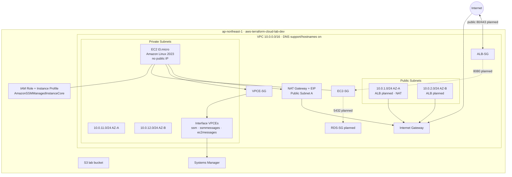

# Architecture Overview

Full service map for the **aws-terraform-cloud-lab** `dev` environment, based on the current Terraform under `terraform/environments/dev/`.

## Diagram



Source Mermaid: [`overview.mmd`](./overview.mmd)



## Inventory of Terraform-managed services

| Area | Resource | Status | Detail |
| --- | --- | --- | --- |
| Network | VPC | Deployed | `10.0.0.0/16`, DNS on |
| Network | Internet Gateway | Deployed | Public egress/ingress edge |
| Network | Public subnets | Deployed | `10.0.1.0/24`, `10.0.2.0/24` |
| Network | Private subnets | Deployed | `10.0.11.0/24`, `10.0.12.0/24` |
| Network | NAT Gateway + EIP | Deployed | Public Subnet A |
| Network | Route tables | Deployed | Public→IGW, Private→NAT |
| Network | SSM Interface VPCEs | Deployed | ssm / ssmmessages / ec2messages |
| Security | ALB / EC2 / RDS / VPCE SGs | Deployed | Least-privilege SG refs |
| Compute | EC2 app | Deployed | Private, `t3.micro`, AL2023 via SSM AMI param |
| Identity | IAM role + instance profile | Deployed | Trust `ec2.amazonaws.com` + SSM core policy |
| Storage | S3 lab bucket | Deployed | Day 1 learning resource |
| Planned | ALB | SG only | Public tier, ports 80/443 |
| Planned | RDS PostgreSQL | SG only | Port 5432 from EC2-SG |
| Planned | Spring Boot on EC2 | User Data stub | `/opt/app/status.txt` today |

## Terraform file map

```
terraform/environments/dev/
├── providers.tf
├── variables.tf
├── terraform.tfvars
├── main.tf              # VPC, subnets, IGW, routes, S3, AMI data
├── nat.tf               # EIP, NAT Gateway, private NAT route
├── security-groups.tf   # ALB / EC2 / RDS SGs + rules
├── vpc-endpoints.tf     # VPCE SG + SSM endpoints
├── iam.tf               # EC2 role, profile, SSM policy
├── ec2.tf               # Private application instance
└── outputs.tf
```

## Deep-dive docs

| Topic | Path |
| --- | --- |
| VPC routing | [`docs/vpc/vpc-routing.md`](../vpc/vpc-routing.md) |
| NAT Gateway | [`docs/networking/nat-gateway.md`](../networking/nat-gateway.md) |
| Security Groups | [`docs/security/security-groups.md`](../security/security-groups.md) |
| Original design notes | [`docs/network-design.md`](../network-design.md) |
