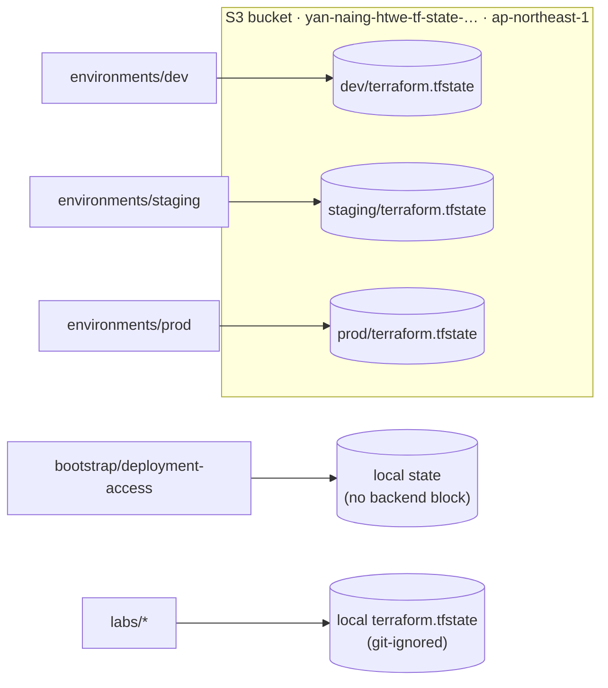
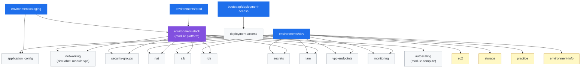
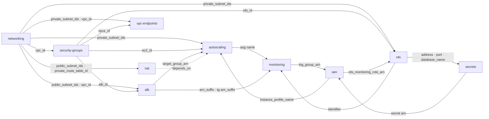
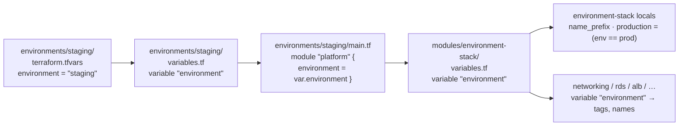
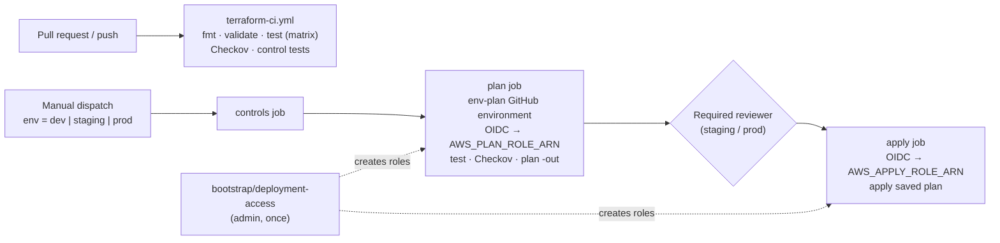

# Project Structure

How the repository is organized, how Terraform roots call modules, and how values such as `var.environment` flow from `terraform.tfvars` into each module.

Related: [module inventory and migration notes](../architecture.md) · [AWS service map](overview.md) · [deployment guide](../deployment.md)

## 1. Repository layout

```text
aws-terraform-cloud-lab/
├── .github/workflows/
│   ├── terraform-ci.yml          # PR/push: fmt, validate, test, Checkov, control tests
│   ├── terraform-deploy.yml      # manual: controls → plan → approval → apply (dev|staging|prod)
│   └── aws-oidc-test.yml         # manual: OIDC plan of terraform/labs/oidc-plan
├── terraform/
│   ├── environments/             # ROOT modules you deploy (one state each)
│   │   ├── dev/                  #   wires 14 modules directly (legacy layout, moved.tf)
│   │   ├── staging/              #   application_config + environment-stack
│   │   └── prod/                 #   environment-stack only
│   ├── modules/                  # CHILD modules (reusable, never run directly)
│   │   ├── environment-stack/    #   composite module used by staging and prod
│   │   └── networking, security-groups, nat, alb, ec2, autoscaling,
│   │       rds, secrets, iam, vpc-endpoints, monitoring, storage,
│   │       application_config, environment-info, practice, deployment-access
│   ├── bootstrap/
│   │   └── deployment-access/    # ROOT: GitHub OIDC plan/apply roles (admin-run, once)
│   └── labs/                     # ROOT: isolated learning exercises, local state, no shared modules
│       ├── deployment-recovery/  #   terraform_data only
│       ├── oidc-plan/
│       ├── security-scanning/
│       ├── state-management/
│       └── workspaces/
├── scripts/                      # deployment-control checks (+ tests) used by CI
├── docs/                         # guides and diagrams
└── app/                          # placeholder for application code
```

**Root vs child module.** A *root* is a directory where you run `terraform init/plan/apply`; it owns a backend and a state file. A *child* module is only ever called from a root (or from another module) through a `module` block. A variable declared in a root gets its value from `terraform.tfvars`, `-var`, or `TF_VAR_*`. A variable declared in a child gets its value from the arguments in the calling `module` block.

## 2. Roots and their state



## 3. Module call graph

Dev still calls the building-block modules itself. Staging and prod call one composite module, `environment-stack`, which calls the same building blocks with environment-dependent settings.



Yellow = used only by dev. Dev runs a single `ec2` instance; staging/prod run `autoscaling` behind the ALB.

## 4. Data flow between modules

Arrows point from the module that **produces** an output to the module that **consumes** it. This is also the order Terraform creates things in. The diagram shows `environment-stack`; dev is the same apart from the differences listed below it.



Differences in dev: `ec2` replaces `autoscaling` and `alb` attaches the instance (`instance_id`) directly. IAM gets no RDS-monitoring or log-group wiring. `monitoring` runs at the `basic` level.

## 5. How a variable flows (`environment` example)



Each hop is a separate variable that happens to share the name. Lab roots such as `labs/deployment-recovery` stop at the first hop and use the variable's `default` because they have no `terraform.tfvars`.

## 6. Delivery pipeline



## 7. Known structural gaps

| Gap | Why it matters | Suggested fix |
| --- | --- | --- |
| Dev does not use `environment-stack` | There are two ways to assemble the same stack, so stack changes must be made twice and dev can drift from staging/prod | Move dev to `module "platform"` with a dev profile (`ec2` vs `autoscaling` toggle). This needs `moved` blocks and a reviewed plan because addresses change from `module.vpc.*` to `module.platform.module.networking.*` |
| `staging/locals.tf` holds a dev/staging/prod size map | It duplicates the sizing inside `environment-stack`, and only staging's `application_config` reads it | Pass sizes from one place, or drop `application_config` from staging |
| CI matrix validates only some modules | `environment-stack`, `rds`, `iam`, `autoscaling`, etc. are validated only indirectly through the environment roots | Add the remaining module directories to the `terraform-ci.yml` matrix |
| `practice`, `environment-info`, `storage` live next to production modules | These are learning modules, not platform modules, so the split between the two is unclear | Leave them in place to avoid state moves, but treat them as dev-only (they are marked yellow above) |
