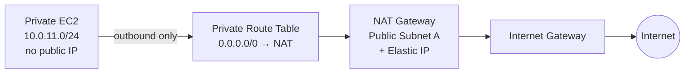

# NAT Gateway

Private EC2 instances in this lab have **no public IP**. They reach the internet for outbound traffic only through a **NAT Gateway**.

## Diagram


Source Mermaid: [`nat-gateway.mmd`](./nat-gateway.mmd)



## Terraform resources

| Resource | File | Purpose |
| --- | --- | --- |
| `aws_eip.nat` | `nat.tf` | Public IPv4 for the NAT Gateway (`domain = "vpc"`) |
| `aws_nat_gateway.main` | `nat.tf` | NAT in `aws_subnet.public[0]` (Public Subnet A) |
| `aws_route.private_nat` | `nat.tf` | Private RT default route `0.0.0.0/0 → NAT` |
| `aws_internet_gateway.main` | `main.tf` | Required upstream of NAT (`depends_on`) |

## Traffic flow

```
Private EC2
→ Private Route Table
→ NAT Gateway (public subnet + Elastic IP)
→ Internet Gateway
→ Internet
```

## Related services in this path

- **VPC / private subnets** — EC2 lives in `10.0.11.0/24` (Private Subnet A)
- **Public subnet A (`10.0.1.0/24`)** — NAT placement (must be public)
- **Elastic IP** — stable public address used by NAT
- **Internet Gateway** — VPC egress to the internet
- **EC2 Security Group** — allows outbound; inbound from internet is still blocked

## What NAT does *not* do

- Does not give EC2 a public IP
- Does not allow inbound SSH/RDP from the internet
- Does not replace Session Manager (SSM) for admin access

## Outputs

- `nat_gateway_id`
- `nat_eip`

## Cost note

NAT Gateway has ongoing AWS charges. Destroy when the lab does not need outbound internet.
