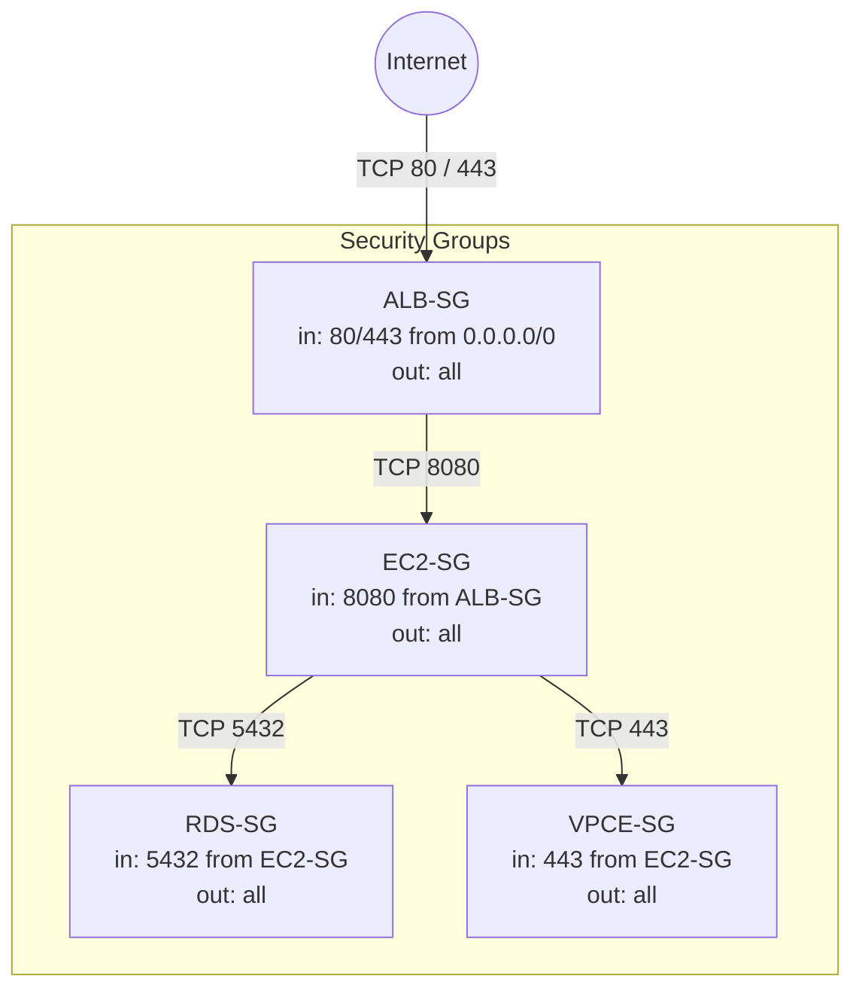

# Security Groups

Security groups enforce the planned path:

```
Internet → ALB → EC2 → RDS
```

EC2 and RDS are **not** reachable directly from the internet.

## Diagram



Source Mermaid: [`security-groups.mmd`](./security-groups.mmd)



## Security groups in detail

### ALB-SG (`aws_security_group.alb`)

| Direction | Protocol | Port | Source / destination |
| --- | --- | --- | --- |
| Inbound | TCP | 80 | `0.0.0.0/0` |
| Inbound | TCP | 443 | `0.0.0.0/0` |
| Outbound | all | all | `0.0.0.0/0` |

Used for the future Application Load Balancer in public subnets.

### EC2-SG (`aws_security_group.ec2`)

| Direction | Protocol | Port | Source / destination |
| --- | --- | --- | --- |
| Inbound | TCP | 8080 | **ALB-SG** (not `0.0.0.0/0`) |
| Outbound | all | all | `0.0.0.0/0` |

Attached to the private application EC2 instance.

### RDS-SG (`aws_security_group.rds`)

| Direction | Protocol | Port | Source / destination |
| --- | --- | --- | --- |
| Inbound | TCP | 5432 | **EC2-SG** (PostgreSQL) |
| Outbound | all | all | `0.0.0.0/0` |

Prepared for a future private RDS database. No internet CIDR allowed inbound.

### VPCE-SG (`aws_security_group.vpce`)

| Direction | Protocol | Port | Source / destination |
| --- | --- | --- | --- |
| Inbound | TCP | 443 | **EC2-SG** |
| Outbound | all | all | `0.0.0.0/0` |

Protects SSM Interface VPC endpoints (`ssm`, `ssmmessages`, `ec2messages`).

## Terraform style note

Rules use the newer resources:

- `aws_vpc_security_group_ingress_rule`
- `aws_vpc_security_group_egress_rule`

Older projects may still use `aws_security_group_rule`.

## Related services

| Service | How SGs apply |
| --- | --- |
| Future ALB | ALB-SG |
| EC2 app | EC2-SG |
| Future RDS | RDS-SG |
| SSM VPC endpoints | VPCE-SG |
| NAT / IGW | Network constructs; not SG-attached |

## Outputs

- `alb_security_group_id`
- `ec2_security_group_id`
- `rds_security_group_id`
- `vpce_security_group_id`
