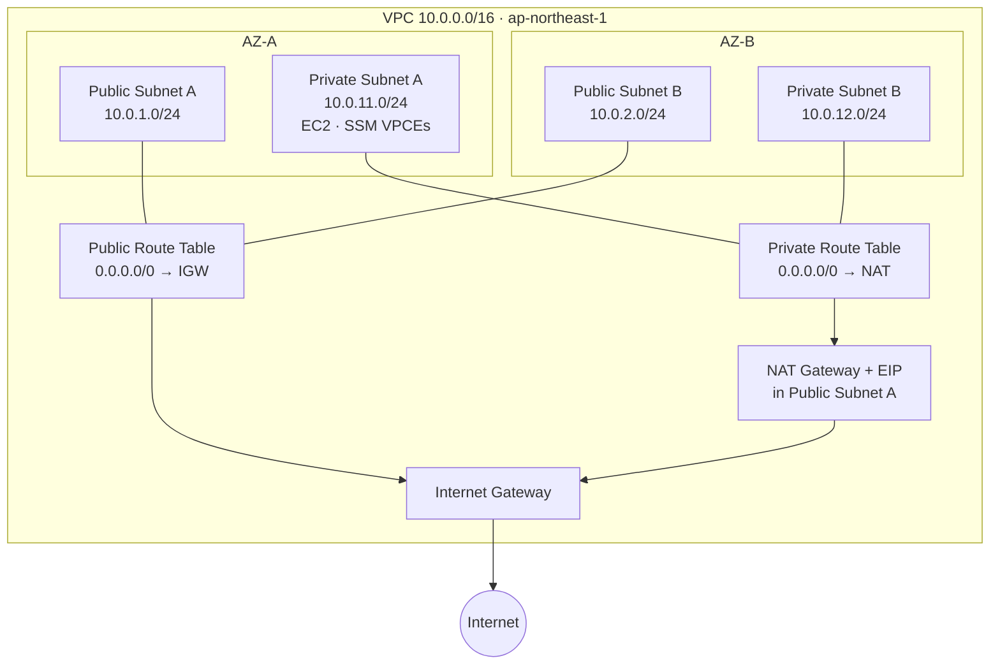

# VPC Routing

Region: **`ap-northeast-1` (Tokyo)**  
VPC CIDR: **`10.0.0.0/16`**  
DNS: `enable_dns_support = true`, `enable_dns_hostnames = true` (required for SSM interface endpoint private DNS)

## Diagram

Source Mermaid: [`vpc-routing.mmd`](./vpc-routing.mmd)

## Subnets

| Name | CIDR | Tier | Typical use |
| --- | --- | --- | --- |
| Public Subnet A | `10.0.1.0/24` | public | NAT Gateway; future ALB |
| Public Subnet B | `10.0.2.0/24` | public | future ALB (second AZ) |
| Private Subnet A | `10.0.11.0/24` | private | EC2 app + SSM VPC endpoints |
| Private Subnet B | `10.0.12.0/24` | private | future app/DB capacity |

Two Availability Zones are used for public/private pairs (`count.index` on AZ list).

## Route tables

### Public route table

| Destination | Target |
| --- | --- |
| `0.0.0.0/0` | Internet Gateway |

Associated with both public subnets.

### Private route table

| Destination | Target |
| --- | --- |
| `0.0.0.0/0` | NAT Gateway |

Associated with both private subnets (no duplicate associations).

## Terraform resources (`main.tf` / `nat.tf`)

- `aws_vpc.main`
- `aws_internet_gateway.main`
- `aws_subnet.public` / `aws_subnet.private` (count = 2)
- `aws_route_table.public` / `aws_route.public_internet`
- `aws_route_table.private` / `aws_route.private_nat`
- `aws_route_table_association.public` / `private`
- `aws_eip.nat` / `aws_nat_gateway.main`

## Workloads placed on this network

| Service | Placement | Notes |
| --- | --- | --- |
| EC2 `aws_instance.app` | Private Subnet A | `t3.micro`, no public IP |
| SSM Interface VPCEs | Private Subnet A | `ssm`, `ssmmessages`, `ec2messages` |
| S3 lab bucket | Regional (not VPC) | Day 1 resource still present |
| ALB / RDS | Not created yet | SGs and CIDRs prepared |

## Related docs

- [NAT Gateway](../networking/nat-gateway.md)
- [Security Groups](../security/security-groups.md)
- [Architecture overview](../architecture/overview.md)
